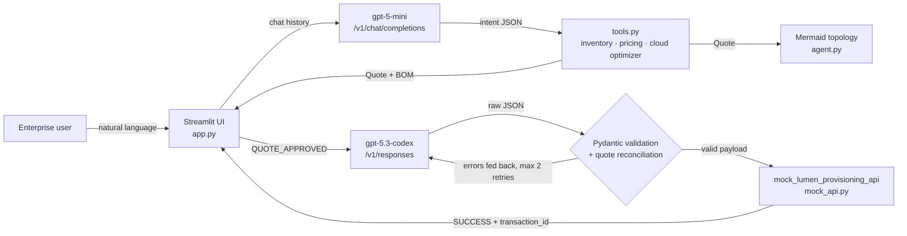

# Lumen Zero-Touch NaaS Broker

> Natural language in, billable and provisioned network out. No sales-engineering queue.

## Executive Summary

The **Lumen Zero-Touch NaaS Broker** is an AI-native ordering agent for Lumen Network-as-a-Service (NaaS).
An enterprise buyer describes the connectivity they need in plain English, for example
*"10 Gbps from our Hyderabad office to the cloud, with DDoS protection."* The broker then:

1. Extracts the intent: location, bandwidth, cloud, add-ons and egress volume.
2. Checks idle on-net port inventory, which means **$0 CapEx** and no construction.
3. Selects the cheapest cloud egress path if the buyer did not name a cloud.
4. Prices a deterministic, hourly **Bill of Materials (BOM)**.
5. Draws the proposed **network topology** as a Mermaid.js diagram.
6. When the buyer approves, compiles a schema-valid `POST /Customer/v3/Ordering/orderRequest` payload, validates
   and corrects it, then sends it to the provisioning layer.

The goal is to remove the manual sales-engineering bottleneck. A conversation can become a provisioned, billable
service in minutes instead of weeks.

> **Mock environment.** This prototype never calls live Lumen APIs. Provisioning goes to
> `mock_lumen_provisioning_api()` in [`mock_api.py`](mock_api.py). That function validates the payload, simulates
> 2 seconds of network latency and returns a simulated `200 OK` with a transaction ID.

---

## The Problem Solved

Traditional enterprise connectivity ordering is a relay race of human hand-offs:

| Stage | Traditional process | Impact |
|-------|---------------------|--------|
| Discovery | The customer emails an account manager, and calls get scheduled. | **Days** before qualification even starts. |
| Solution design | A sales engineer checks inventory, chooses port speeds and looks up cloud on-ramps by hand. | Results depend on who does the work. The cheapest cloud path is often missed. |
| Quoting | Pricing is built in spreadsheets and goes through deal-desk review. | Pricing errors, version drift and **1–3 week** quote cycles. |
| Order entry | A person re-keys the approved quote into the ordering API or OSS/BSS portal. | **Human API-translation errors**, such as a wrong site code, speed or billing rate. These cause rejected orders and rework. |
| Provisioning | Tickets are handed to operations. | More delay, and nobody has a single view of status. |

The result is **high friction, slow time-to-revenue and avoidable order fallout**, even though Lumen's NaaS
platform can already provision capacity on demand. People are the bottleneck, not the network.

## Revenue Benefits to Lumen

- **Faster time-to-revenue:** Quote-to-provision drops from weeks to minutes. Hourly billing starts when the
  customer approves, not after a long order-entry cycle.
- **Higher NaaS consumption:** A low-friction, self-service experience encourages more and smaller orders, plus
  upgrades such as 1G to 10G or adding DDoS protection. Each order adds recurring hourly revenue.
- **Better use of existing capacity:** The $0 CapEx check sells idle on-net ports first. This earns revenue from
  assets Lumen has already paid for.
- **Built-in upsell:** DDoS mitigation and multi-cloud on-ramps appear in context in every quote.
- **Fewer rejected orders:** Pydantic schema validation and reconciliation against the quote stop wrong-rate or
  wrong-site orders from reaching billing.
- **Room to grow without more headcount:** Sales engineers can focus on complex, high-value deals. The broker
  handles the standard requests.
- **Customer trust:** Showing the cheapest-cloud comparison builds goodwill and can make Lumen the preferred
  multi-cloud fabric.

---

## Architecture & Flow



### 1. Conversational NLU: `gpt-5-mini` (Chat Completions)

Every chat turn goes to the low-cost `gpt-5-mini` model through `/v1/chat/completions` in JSON mode.
Settings: `reasoning_effort="low"`, a 12-message history window and a completion-token cap. The model **only
extracts intent**: customer, source city, bandwidth in Mbps, cloud provider, DDoS protection, egress GB per month
and a short reply. It never calculates prices, so prices cannot be hallucinated.

### 2. Deterministic BOM, $0 CapEx check and multi-cloud optimizer: `tools.py`

- **Port selection:** chooses the smallest port that fits, or N × 10G for larger demand.
- **$0 CapEx check:** confirms there are enough idle on-net ports at the site. If there are not, the broker
  suggests other on-net sites in the same region that have capacity.
- **Multi-cloud cost optimization:** if the user does not name a cloud, it compares AWS, GCP and Azure. For each
  one it calculates on-ramp cost plus amortised regional egress (`egress $/GB × GB/mo ÷ 730 h`) and picks the
  cheapest. The full comparison is shown in the UI. For example, Seattle picks AWS, London picks GCP and
  Hyderabad 1G picks Azure.
- **BOM:** port, cloud on-ramp, estimated egress, optional DDoS protection and a $0 on-net CapEx line, all priced
  per hour.

### 3. Visual topology: `generate_mermaid_diagram()`

The diagram is built deterministically, so it costs no tokens. It shows
**Customer Site → Lumen PoP → Lumen NaaS Fabric → Cloud on-ramp**, with a DDoS scrubbing node when that add-on is
selected. Mermaid.js renders it in a sandboxed iframe with `securityLevel: "strict"`.

### 4. Payload compilation: `gpt-5.3-codex` (Responses API)

Codex runs **only** when the latest user message contains `QUOTE_APPROVED`, either from the **Approve Quote**
button or typed in chat. It is called through `/v1/responses` with `store=False`. Its input is the endpoint's JSON
Schema from `lumen_context.json`, the approved quote and an explicit field mapping.

### 5. Self-healing validation and mock execution

1. Pydantic (`mock_api.OrderRequest`) validates the Codex output. Strict ints and booleans are required, and
   unknown keys are rejected.
2. **Reconciliation** checks that every payload value matches the approved quote: site, speed, cloud, region,
   DDoS setting and billing rate within ±$0.005.
3. On failure, the exact errors and the rejected output go back to Codex for a correction. The broker tries at
   most `1 + MAX_HEAL_ATTEMPTS` times.
4. The validated payload goes to `mock_lumen_provisioning_api()`. This function logs the payload, sleeps 2 seconds
   to imitate network latency, validates the payload again as the server would, and returns:

```json
{"status": "SUCCESS", "http_status": 200, "transaction_id": "LUMEN-NAAS-12345",
 "message": "Network provisioned", "quote_id": "Q-1A2B3C4D", "provisioned_at": "..."}
```

The mock API stands in for the physical network layer, so the full workflow can run end to end without touching
production Lumen systems.

### Cost controls (USD 20 budget)

- **Development profile (default):** `MODEL_PROFILE=dev` runs both roles on `gpt-5.6-luna`, the cheapest model on
  the hackathon gateway. It was measured with the app's real requests (see the table below). **Production
  profile:** `MODEL_PROFILE=prod` uses `gpt-5-mini` for NLU and `gpt-5.3-codex` for the payload.
- The payload model runs **once per approved quote**, plus at most 2 correction retries.
- Pricing, inventory, cloud optimization and diagrams are plain Python, so they use no tokens.
- Reasoning effort is `low`, output tokens are capped and the chat history is windowed.
- The sidebar spend meter uses the **cost the gateway reports for each call** (`x-litellm-response-cost`) and falls
  back to the price table in `config.py` only when that header is missing. A per-session budget guard
  (`SESSION_BUDGET_USD`, default $2.00) blocks further LLM calls once the limit is reached.

Measured cost per call on the gateway, using one real NLU request (about 350 input tokens) and one real payload
request (about 1,300 input tokens). Costs vary slightly with the model's reasoning length:

| Model | NLU `/chat/completions` | Payload `/responses` |
|-------|-------------------------|----------------------|
| `gpt-5.6-luna` | **$0.00018** | **$0.0002–0.0005** |
| `gpt-5-mini` | $0.00029 | $0.0008–0.0012 |
| `gpt-4.1` / `gpt-4o` | $0.0014 / $0.0016 | not tested |
| `gpt-5` | $0.0015 | not tested |
| `gpt-5.1-codex` / `gpt-5.2-codex` | not listed for chat | $0.0031 / $0.0045 |
| `gpt-5.4` / `gpt-5.6-terra` / `gpt-5.6-sol` / `claude-sonnet-4-6` | $0.0022 / $0.0025 / $0.0037 / $0.0032 | not tested |
| `gpt-5.2` / `gpt-5.5` | $0.0028 / $0.0061 | not tested |

All measured responses passed schema validation. `gpt-5-codex` and `gpt-5.3-codex` returned transient `429` rate
limits during the test, so their cost was not measured.

---

## Project Structure

```
.
├── app.py               # Streamlit UI: chat, BOM, topology, approval workflow
├── agent.py             # LLM orchestration: NLU, Mermaid, Codex + self-healing
├── tools.py             # Context loading, $0 CapEx check, cloud optimizer, BOM pricing
├── mock_api.py          # Pydantic orderRequest schema + mock provisioning API
├── config.py            # Env vars, model routing, budget constants
├── logging_setup.py     # Rotating file + console logging, key redaction, diagnostics
├── lumen_context.json   # Mock on-net sites, pricing, DDoS, cloud egress, API JSON schema
├── requirements.txt
├── .env.example
└── README.md
```

## Setup Instructions

**Prerequisites:** Python 3.11+ and an LLM key. By default the app uses the **hackathon LiteLLM gateway** (team key
plus base URL from the *2026 Hackathon Team LLM Access Guide*). Plain OpenAI also works.

```powershell
# 1. Create and activate a virtual environment
python -m venv .venv
.\.venv\Scripts\Activate.ps1          # macOS/Linux: source .venv/bin/activate

# 2. Install dependencies (use the SAME interpreter that will run the app)
python -m pip install -r requirements.txt

# 3. Configure the gateway
Copy-Item .env.example .env           # macOS/Linux: cp .env.example .env
# then edit .env: set LITELLM_API_KEY (your team key) and LITELLM_BASE_URL (from the guide)
# Or just for the current PowerShell session:
#   $env:LITELLM_API_KEY  = "<team key>"
#   $env:LITELLM_BASE_URL = "<gateway base URL>"

# 4. Run the app (any of these)
streamlit run app.py
python app.py                         # re-launches itself under Streamlit
```

Then click **🔌 Test LLM connection** in the sidebar. It sends two tiny requests (about $0.0001) to confirm that
both configured models are reachable and allowed for your key.

In VS Code you can press **F5** and choose **Streamlit: Lumen NaaS Broker** from `.vscode/launch.json`.

> **Troubleshooting `ModuleNotFoundError` (for example `No module named 'dotenv'`):** `pip` installed the
> packages into a different Python than the one running the app. Install with the exact interpreter you run, for
> example `& "C:\...\Python314\python.exe" -m pip install -r requirements.txt`. Or pick the matching interpreter
> with **Python: Select Interpreter** in VS Code.

Open <http://localhost:8501> and try:

1. `We're Contoso. Need 10 Gbps from Seattle to the cloud with DDoS protection.` The optimizer picks the cloud.
2. `Switch it to Azure and make it 1 Gbps.` The quote is updated in context.
3. `5 Gbps from Denver to AWS.` The $0 CapEx check fails because Denver has no idle 10G ports, and the broker
   suggests alternatives.
4. Click **✅ Approve Quote**, or type `QUOTE_APPROVED`. Codex compiles the order, it is validated and the mock
   API provisions it.

### Configuration

| Variable | Default | Purpose |
|----------|---------|---------|
| `LITELLM_API_KEY` | *(required)* | Hackathon team key (`OPENAI_API_KEY` is accepted as a fallback) |
| `LITELLM_BASE_URL` | `https://api.openai.com/v1` | Gateway base URL from the access guide (`OPENAI_BASE_URL` also accepted). **Required for team keys**: the app refuses to send a team key to `api.openai.com` |
| `MODEL_PROFILE` | `dev` | `dev` = `gpt-5.6-luna` for both roles (cheapest on the gateway); `prod` = `gpt-5-mini` (NLU) + `gpt-5.3-codex` (payload) |
| `NLU_MODEL` | from profile | Overrides the intent extraction model |
| `CODEX_MODEL` | from profile | Overrides the payload compiler model |
| `SESSION_BUDGET_USD` | `2.00` | Per-session spend guard |
| `OPENAI_TIMEOUT_SECONDS` / `OPENAI_MAX_RETRIES` | `60` / `2` | SDK resilience |

Token prices for the spend meter are in `config.MODEL_PRICING_PER_MTOK`. Update them if OpenAI changes its pricing.

### Logging & diagnostics

- **Where:** `logs/broker.log` (rotating, 2 MB × 3, gitignored) holds the full DEBUG log. The console shows INFO
  and above. The sidebar has a **🪵 Diagnostic log** viewer and a **🔌 Test LLM connection** button (two tiny
  requests, about $0.0001).
- **Startup:** Python and package versions, model profile, endpoint and which env var supplied it, proxy and
  certificate variables, and a non-reversible API-key fingerprint (length, prefix, SHA-256 prefix, key format).
- **Per LLM call:** model, reasoning effort, message sizes, duration, token usage, estimated cost, finish reason
  and the `request_id`. On failure it also logs the HTTP status, the gateway's error body (`message` or LiteLLM's
  `detail`), `x-litellm-*` headers (such as the call id) and the full cause chain. Quote the call id when asking
  the hackathon team for help.
- **Secrets:** anything that looks like an API key (`sk-…`) or bearer token is masked in every log line.

> **Gateway 401/403:** LiteLLM team keys are restricted by route *and* by model, and the app shows the gateway's
> own message so you can tell which problem you have:
> 1. *"Invalid proxy server token"*: the key is wrong or revoked, or `LITELLM_BASE_URL` points at a different
>    gateway than the one that issued it.
> 2. *"…model … is not available for this API key"* or *"key not allowed to access model"*: set `NLU_MODEL` /
>    `CODEX_MODEL` in `.env` to a model your key may use. Chat models available to all teams: `gpt-5.6-sol`,
>    `gpt-5.6-luna`, `gpt-5.6-terra`, `gpt-5.5`, `gpt-5.4`, `gpt-5.2`, `gpt-5`, `gpt-5-mini`, `gpt-4.1`, `gpt-4o`,
>    `claude-sonnet-4-6`. Responses-API models: `gpt-5.3-codex`, `gpt-5.2-codex`, `gpt-5.1-codex`, `gpt-5-codex`.
> 3. *"Virtual key is not allowed to call this route"*: the key may only call `/chat/completions`, `/responses`
>    and `/embeddings`. The app uses only the first two, and does not call `/v1/models`.
>
> A 401 `invalid_api_key` from `api.openai.com` means a gateway key was sent to OpenAI. Set `LITELLM_BASE_URL`.
>
> **`CERTIFICATE_VERIFY_FAILED` in the log:** the gateway uses an internal certificate authority that this Python
> or SDK build does not trust. Use a current `openai` release (it trusts the OS certificate store), or point
> `SSL_CERT_FILE` at your corporate CA bundle.

### Notes

- The Mermaid diagram loads `mermaid.js` from the jsDelivr CDN in the browser. All Lumen API interaction is
  mocked locally.
- Error handling: OpenAI failures (authentication, rate limit, timeout, connection, model not found, bad request)
  and validation failures appear as friendly messages in the chat. The app never shows a stack trace.
